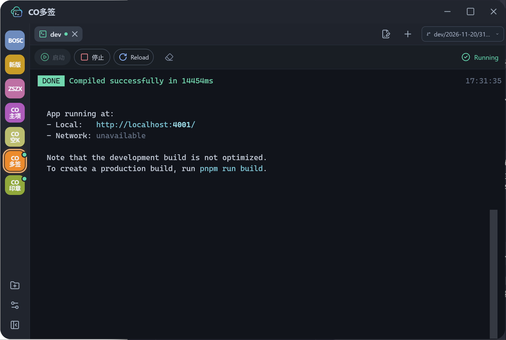
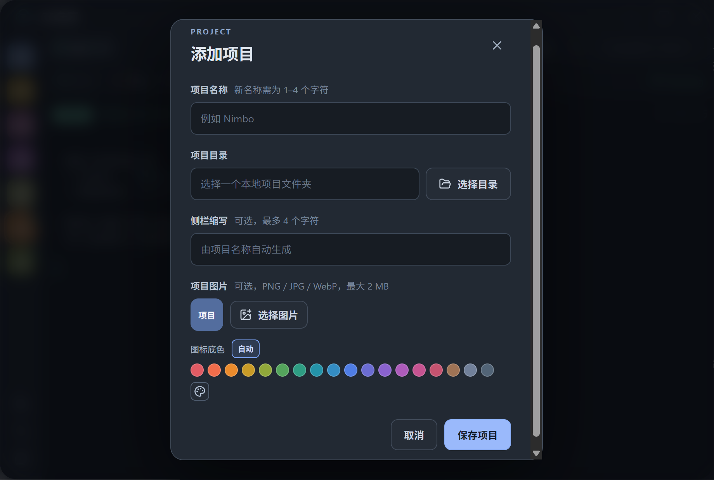
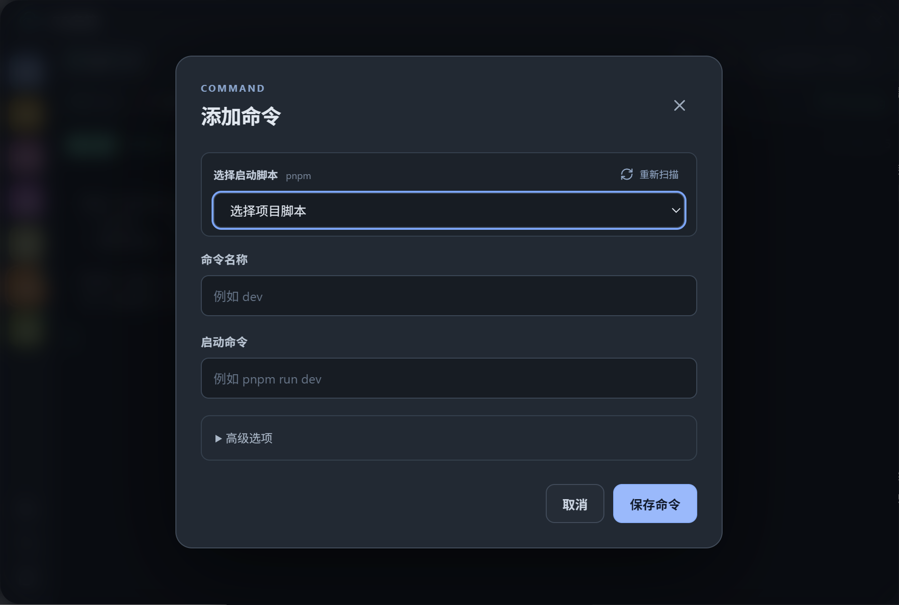

# Nimbo Terminal

**English** | [简体中文](README.zh-CN.md)

Nimbo Terminal keeps your local projects, development commands, and terminal output together in one desktop workspace. Add a project once, choose a script from its `package.json`, then run and manage it from the project sidebar.

[Download the latest release](https://github.com/eminoda/nimbo/releases/latest)

## The main window

The left sidebar holds your projects. The top row contains a project's command tabs and, for Git projects, its branch selector. Use the action bar to start, stop, or reload a command. The terminal below displays output and accepts input.

## Add a project

1. Select **Add project** at the bottom of the left sidebar.
2. Enter a project name (1–4 characters) and choose the local project folder.
3. Optionally change the sidebar label. It is generated from the project name by default and can contain up to four characters.
4. Optionally choose a project image (PNG, JPG, or WebP; up to 2 MB) and set its background to automatic, a preset color, or a custom color.
5. Select **Save project**.

Drag a project icon to reorder the sidebar. Right-click an icon to edit or delete that project, or open it in an installed Codex, VS Code, or Cursor client.

## Add a command

Select the **+** beside the command tabs. Nimbo reads the project's `package.json`, detects the package manager, and lists the available scripts.

1. Choose a script. Nimbo fills in the command name and startup command; you can edit either field.
2. If you changed `package.json`, select **Rescan** to refresh the script list.
3. If no script is available, enter a command manually.
4. Expand **Advanced options** to set a working directory (the project folder is used by default) or environment variables, one `KEY=value` entry per line.
5. Select **Save command**.

## Run commands in the terminal

Select a command tab and choose **Start**. Its terminal session stays associated with that command, so switching tabs preserves each command's output and session.

- Type commands directly into the terminal and press Enter. On Windows, the interactive shell uses Command Prompt.
- Press **Ctrl+C** or choose **Stop** to interrupt the current foreground command. The terminal remains available for more input.
- Choose **Reload** to interrupt the current command and run the command's saved startup command again.
- Choose the eraser button to clear the visible terminal output.

## Switch Git branches

For a Git project, Nimbo shows the current branch beside the command tabs. Open the selector to load and search local branches, then choose a branch to switch to it. Branches checked out in another worktree are marked **Worktree**. Stop the project's running commands before switching branches.

## Use the compact project dock

Select the panel icon at the bottom of the sidebar to collapse Nimbo into a small, always-on-top project dock. It keeps the project list visible; use the expand icon at the bottom of the dock to return to the full window.

## Settings and project data

Select the settings icon at the bottom of the sidebar to open Nimbo's local configuration file. Project bookmarks and preferences are stored on your device.

## Troubleshooting

- **No scripts appear:** Make sure the project folder contains a `package.json` with a `scripts` section, then select **Rescan**. You can also enter a command manually.
- **A branch cannot be selected:** Stop any running command for that project first. A branch marked **Worktree** is already checked out in another worktree.
- **An IDE is missing from the menu:** Right-click the project and select **Open in IDE**. Use **Rescan** in the submenu after installing or changing an editor.
