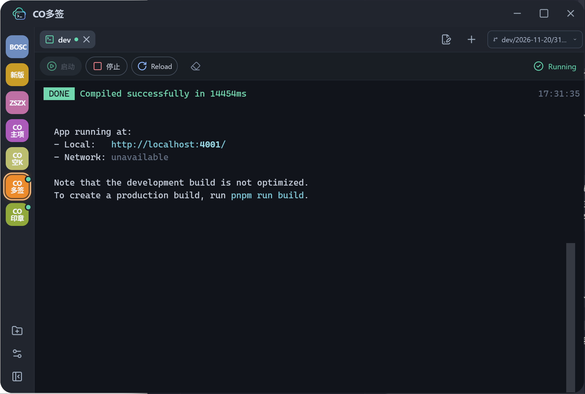
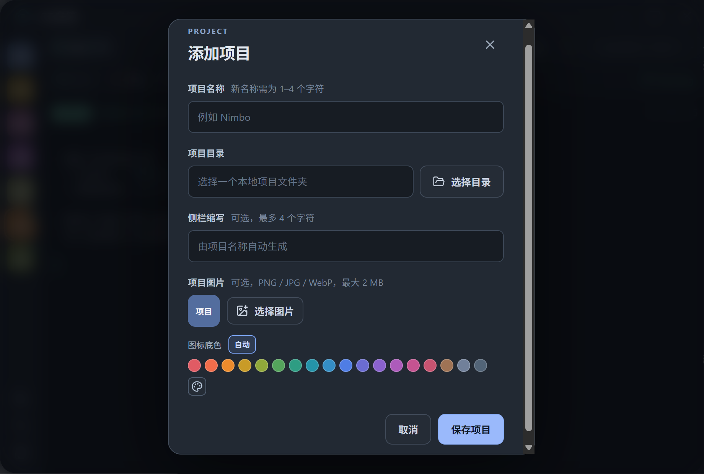
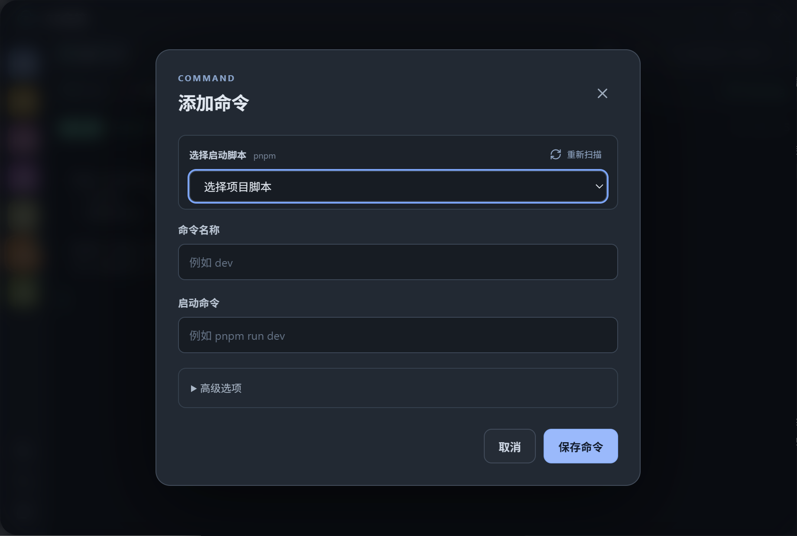

# Nimbo Terminal

[English](README.md) | **简体中文**

Nimbo Terminal 将本地项目、开发命令和终端输出集中在一个桌面工作区中。添加项目后，可以从它的 `package.json` 选择脚本，再通过侧边栏管理和运行命令。

[下载最新版本](https://github.com/eminoda/nimbo/releases/latest)

## 主界面

左侧栏用于切换项目。顶部一行显示项目的命令标签；Git 项目还会显示分支选择器。操作栏可以启动、停止或重新加载命令，下方终端用于查看输出和输入命令。

## 添加项目

1. 点击左侧栏底部的**添加项目**。
2. 输入项目名称（1–4 个字符），并选择本地项目目录。
3. 可选修改侧栏缩写。默认根据项目名称生成，最多 4 个字符。
4. 可选上传项目图片（PNG、JPG 或 WebP，最大 2 MB），并设置图标底色：自动、预设颜色或自定义颜色。
5. 点击**保存项目**。

拖动项目图标可以调整侧栏顺序。右键点击图标，可以编辑或删除项目，也可以在已安装的 Codex、VS Code 或 Cursor 客户端中打开项目。

## 添加命令

点击命令标签旁的 **+**。Nimbo 会读取项目的 `package.json`，识别包管理器并列出可用脚本。

1. 选择一个脚本。Nimbo 会自动填入命令名称和启动命令，也可以自行修改。
2. 如果修改了 `package.json`，点击**重新扫描**更新脚本列表。
3. 如果没有可选脚本，可以手动输入启动命令。
4. 展开**高级选项**，可设置工作目录（默认使用项目目录）和环境变量；环境变量每行填写一个 `KEY=value`。
5. 点击**保存命令**。

## 在终端中运行命令

选择命令标签并点击**启动**。每个命令都有独立的终端会话，切换标签时会保留各自的会话和输出。

- 可以直接在终端中输入命令并按 Enter。在 Windows 上，交互式终端使用命令提示符（Command Prompt）。
- 按 **Ctrl+C** 或点击**停止**，可以中断当前前台命令；终端仍可继续输入命令。
- 点击 **Reload**，可以中断当前命令并重新运行该命令保存的启动命令。
- 点击橡皮擦按钮可以清除终端中显示的输出。

## 切换 Git 分支

Git 项目的当前分支会显示在命令标签旁。打开分支选择器后，Nimbo 会读取本地分支列表；可以搜索并选择分支进行切换。已在其他 worktree 中检出的分支会标记为 **Worktree**。切换分支前，请先停止该项目正在运行的命令。

## 使用缩小后的项目栏

点击侧边栏底部的面板图标，可以将 Nimbo 缩小为始终置顶的项目栏，只保留项目列表。点击缩小栏底部的展开图标即可返回完整窗口。

## 设置与项目数据

点击侧边栏底部的设置图标，可以打开 Nimbo 的本地配置文件。项目书签和偏好设置保存在本机。

## 常见问题

- **没有显示脚本：** 确认项目目录中有包含 `scripts` 的 `package.json`，然后点击**重新扫描**；也可以手动输入命令。
- **无法选择分支：** 请先停止该项目正在运行的命令。标记为 **Worktree** 的分支已在其他 worktree 中检出。
- **菜单中没有显示 IDE：** 右键点击项目并选择**在 IDE 中打开**。安装或更换编辑器后，可在子菜单中点击**重新扫描**。
